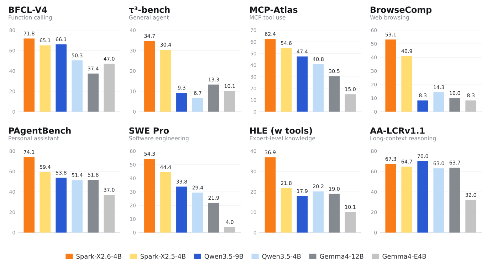
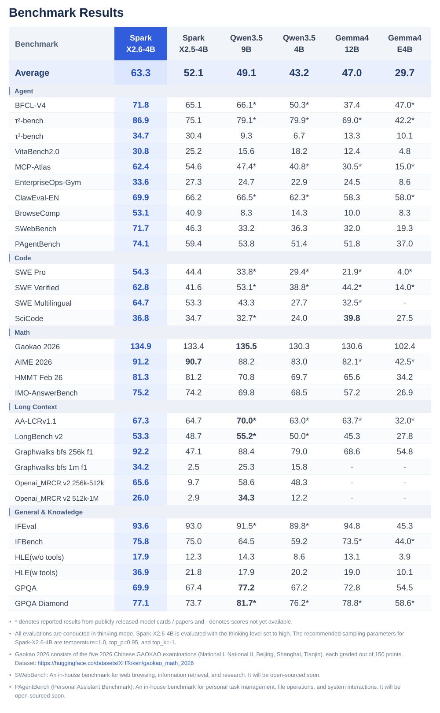
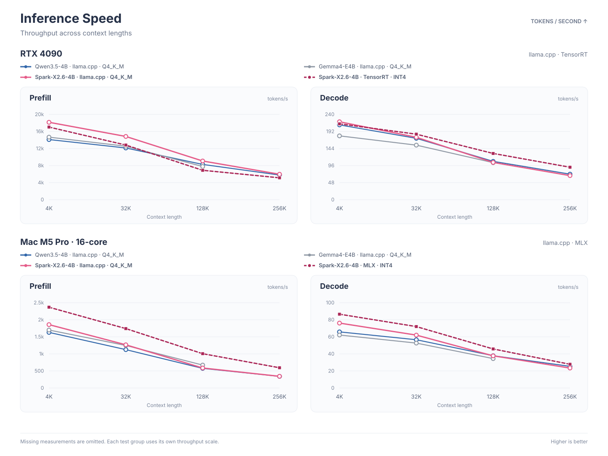

<p align="center">
  
</p>
<h1 align="center">Spark-X2.6-4B: Advancing the Frontier of On-Device Agents for Real-World Tasks</h1>

<div align="center">

[](https://join.slack.com/t/tokenspark/shared_invite/zt-432qf8l2f-5~dLyXv8uETr0P0UuC07nw)
[](https://discord.gg/kTDE2Hg8aw)
[](https://www.youtube.com/@SparkLLM)
[](https://dev.to/sparkllm)
[](https://bsky.app/profile/sparkllm.bsky.social)
[](https://x.com/sparkllm)
[](https://www.zhihu.com/people/zhiikz7qh7m)
[](https://github.com/XHToken/community/blob/main/docs/images/xhtoken-wechat.jpg)

</div>

Welcome to the GitHub repository of Spark-X2.6 open model series. You can find official information about Spark-X2.6, and post your questions [here(Issues)](https://github.com/XHToken/Spark-X2.6/issues).

<p align="center">
  
</p>

## Introduction
A little over a month has passed since Spark-X2.5. In the rapidly evolving world of AI agents, that is enough time to rethink, refine, and move the frontier forward. Building on the Spark-X2.5-4B, we introduce **Spark-X2.6-4B**, the latest generation of our compact, general-purpose language models for on-device deployment. 

Spark-X2.6-4B retains exactly the same architecture as Spark-X2.5-4B, achieving its capability gains through improved post-training. It delivers substantial improvements in coding, agent, long-context, multilingual, reasoning, etc. These advances enable more capable and practical on-device AI for developers and users tackling real-world tasks.

**Technical Highlights**:
- **Stronger Coding, Agentic, and Long-Context Capabilities**: The models deliver substantial improvements in agentic workflows involving complex tool use, multi-step planning, and software engineering. They achieve state-of-the-art performance among similarly sized open-source models, matching or even surpassing models with approximately 9B parameters.
- **Controllable Thinking Budget**: The models provide three configurable thinking levels—none, low, high—allowing applications to balance reasoning quality, latency, and inference cost dynamically.

## Release

- **[2026/10/21] 🚀 Global launch of the Spark-X2.6 model series on [Hugging Face](https://huggingface.co/collections/XHToken/spark-x26), [ModelScope](https://www.modelscope.cn/collections/XHToken/Spark-X26), [Ollama](https://ollama.com/SparkLLM).**
- [2026/09/06] 🤝 Added native model architecture support for Spark‑X2.5 & X2.6 (Spark2_5ForCausalLM) in [llama.cpp](https://github.com/ggml-org/llama.cpp/releases/tag/b10829).
- [2026/09/01] 🚀 Global launch of the Spark-X2.5 model series on [Hugging Face](https://huggingface.co/collections/XHToken/spark-x25), [ModelScope](https://www.modelscope.cn/collections/XHToken/Spark-X25), [Ollama](https://ollama.com/SparkLLM), [Modelers](https://modelers.cn/user/XHToken), and [SCNet](https://www.scnet.cn/ui/aihub/models/XHToken/Spark-X2.5-4B).

## Model Downloads

Spark-X2.6-4B is available on the following platforms. Choose the most suitable download source for your region and environment:

| Platform | Download | Description |
| --- | --- | --- |
| Hugging Face | [Spark-X2.6 in Huggingface](https://huggingface.co/collections/XHToken/spark-x26) | Official Hugging Face model collection for Spark-X2.6 |
| ModelScope | [Spark-X2.6 in ModelScope](https://www.modelscope.cn/collections/XHToken/Spark-X26) | Recommended download source for users in China |
| Ollama | [Spark-X2.6 in Ollama](https://ollama.com/SparkLLM) | Download and run the model locally with Ollama |


## Benchmarks
We evaluate our models and compare them with leading on-device models of similar size across a broad range of tasks, including agent, code, math,  general and knowledge.
Spark-X2.6-4B achieves best-in-class performance among models of comparable size, while matching or exceeding the performance of larger 9B models on several benchmarks.

<p align="center">
  
</p>


## Edge Inference
Spark-X2.6-4B delivers inference efficiency on par with or better than comparable on-device models, including Qwen3.5-4B and Gemma-E4B. It combines this efficiency with stronger capabilities, making it a practical choice for responsive, resource-conscious on-device AI.
<p align="center">
  
</p>


## Quickstart

### Transformers

Install the required version with `pip install transformers==4.57.1`.

```python
from transformers import AutoModelForCausalLM, AutoTokenizer
model_id = "XHToken/Spark-X2.6-4B"
tokenizer = AutoTokenizer.from_pretrained(model_id)
model = AutoModelForCausalLM.from_pretrained(
    model_id,
    trust_remote_code=True,
    torch_dtype="auto",
    device_map="auto",
)
messages = [{"role": "user", "content": "What is the capital of Anhui Province?"}]
inputs = tokenizer.apply_chat_template(
    messages,
    tokenize=True,
    add_generation_prompt=True,
    enable_thinking=True,
    return_dict=True,
    return_tensors="pt",
).to(model.device)
outputs = model.generate(
    **inputs,
    max_new_tokens=131072,
    do_sample=True,
    temperature=1.0,
    top_p=0.95,
    top_k=0,
)
print(tokenizer.decode(outputs[0][inputs["input_ids"].shape[-1]:], skip_special_tokens=True))
```

### SGLang

The examples below serve a local Spark-X2.6-4B checkpoint. Set `MODEL_PATH` to its absolute path before starting a container:

```bash
export MODEL_PATH=/absolute/path/to/Spark-X2.6-4B
```

#### Install SGLang

Use the pre-built image that tracks the Spark-X2.6 runtime:

##### For NVIDIA GPUs:

```bash
docker pull lmsysorg/sglang:nightly-dev-cu13-20260827-20621aa1
```
##### For Ascend NPUs:

```bash
# A3 daily build
export SGLANG_IMAGE=quay.io/ascend/sglang:main-cann9.0.0-a3

# A2 daily build (use this instead on A2 hardware)
export SGLANG_IMAGE=quay.io/ascend/sglang:main-cann9.0.0-910b

docker pull "$SGLANG_IMAGE"
```

#### Run Inference

The following commands start an OpenAI-compatible API server configured for a maximum context length of 1,048,576 tokens. This setting requires sufficient device memory; reduce `--context-length` when necessary.

#### Server

##### NVIDIA GPU:

```bash
docker run --rm -it \
  --gpus '"device=0"' \
  --ipc=host \
  -p 30000:30000 \
  -v "$MODEL_PATH:/root/Spark-X2.6-4B:ro" \
  lmsysorg/sglang:nightly-dev-cu13-20260827-20621aa1 \
  python -m sglang.launch_server \
    --model-path /root/Spark-X2.6-4B \
    --served-model-name spark2.6 \
    --tool-call-parser spark25 \
    --reasoning-parser qwen3 \
    --tp-size 1 \
    --mem-fraction-static 0.8 \
    --context-length 1048576 \
    --chat-template /root/Spark-X2.6-4B/chat_template.jinja \
    --host 0.0.0.0 \
    --port 30000
```

##### Ascend NPU:

```bash
docker run -it --rm -e ASCEND_USE_FIA=1 --network=host --ipc=host --shm-size=16g \
    --device=/dev/davinci0 --device=/dev/davinci1 --device=/dev/davinci2 --device=/dev/davinci3 \
    --device=/dev/davinci4 --device=/dev/davinci5 --device=/dev/davinci6 --device=/dev/davinci7 \
    --device=/dev/davinci8 --device=/dev/davinci9 --device=/dev/davinci10 --device=/dev/davinci11 \
    --device=/dev/davinci12 --device=/dev/davinci13 --device=/dev/davinci14 --device=/dev/davinci15 \
    --device=/dev/davinci_manager \
    --device=/dev/devmm_svm \
    --device=/dev/hisi_hdc \
    --volume /usr/local/sbin:/usr/local/sbin \
    --volume /usr/local/Ascend/driver:/usr/local/Ascend/driver \
    --volume /usr/local/Ascend/firmware:/usr/local/Ascend/firmware \
    --volume /etc/ascend_install.info:/etc/ascend_install.info \
    --volume /var/queue_schedule:/var/queue_schedule \
    --volume ~/.cache/:/root/.cache/ \
    --volume "$MODEL_PATH:/root/Spark-X2.6-4B:ro" \
    --entrypoint=python \
    "$SGLANG_IMAGE" \
    -m sglang.launch_server \
      --model-path /root/Spark-X2.6-4B \
      --served-model-name spark2.6 \
      --tool-call-parser spark25 \
      --reasoning-parser qwen3 \
      --tp-size 1 \
      --mem-fraction-static 0.8 \
      --context-length 1048576 \
      --chat-template /root/Spark-X2.6-4B/chat_template.jinja \
      --host 0.0.0.0 \
      --port 30000
```

#### Client

Thinking is enabled by default by both the chat template and the Qwen3 reasoning parser. To disable thinking for a specific request, set `"chat_template_kwargs": {"enable_thinking": false}`.

```bash
curl -s http://localhost:30000/v1/chat/completions \
  -H "Content-Type: application/json" \
  -d '{
    "model": "spark2.6",
    "messages": [
      {
        "role": "user",
        "content": "安徽的省会在哪里？"
      }
    ],
    "max_tokens": 131072,
    "temperature": 1,
    "top_k": -1,
    "top_p": 0.95,
    "repetition_penalty": 1,
    "presence_penalty": 0,
    "frequency_penalty": 0
  }'
```

### vLLM

#### Deploy vLLM

vLLM provides an official Docker image for NVIDIA GPU deployment:

```bash
docker run --rm --gpus all \
  --ipc=host \
  -p 30000:30000 \
  -v "$MODEL_PATH:/models/Spark-X2.6-4B:ro" \
  vllm/vllm-openai:latest \
  --model /models/Spark-X2.6-4B \
  --port 30000 \
  --trust-remote-code \
  --served-model-name spark25 \
  --tensor-parallel-size 1 \
  --gpu-memory-utilization 0.7 \
  --enable-prefix-caching \
  --chat-template /models/Spark-X2.6-4B/chat_template.jinja
```

For Ascend NPUs, choose an official image for the fastest setup.

##### Ascend A2:

```bash
export IMAGE=quay.io/ascend/vllm-ascend:nightly-main
docker pull "$IMAGE"

export DEVICE=/dev/davinci0
export MODEL_CACHE="${HOME}/.cache"

mkdir -p "$MODEL_CACHE"

docker run --rm \
    --name vllm-ascend \
    --shm-size=1g \
    --device "$DEVICE" \
    --device /dev/davinci_manager \
    --device /dev/devmm_svm \
    --device /dev/hisi_hdc \
    -v /usr/local/dcmi:/usr/local/dcmi \
    -v /usr/local/bin/npu-smi:/usr/local/bin/npu-smi \
    -v /usr/local/Ascend/driver/lib64/:/usr/local/Ascend/driver/lib64/ \
    -v /usr/local/Ascend/driver/version.info:/usr/local/Ascend/driver/version.info \
    -v /etc/ascend_install.info:/etc/ascend_install.info \
    -v "$MODEL_CACHE:/root/.cache" \
    -p 8000:8000 \
    -it "$IMAGE" bash
```

##### Ascend A3:

```bash
export IMAGE=quay.io/ascend/vllm-ascend:nightly-main-a3
docker pull "$IMAGE"

export DEVICE0=/dev/davinci0
export DEVICE1=/dev/davinci1
export MODEL_CACHE="${HOME}/.cache"

mkdir -p "$MODEL_CACHE"

docker run --rm \
    --name vllm-ascend \
    --shm-size=1g \
    --device "$DEVICE0" \
    --device "$DEVICE1" \
    --device /dev/davinci_manager \
    --device /dev/devmm_svm \
    --device /dev/hisi_hdc \
    -v /usr/local/dcmi:/usr/local/dcmi \
    -v /usr/local/bin/npu-smi:/usr/local/bin/npu-smi \
    -v /usr/local/Ascend/driver/lib64/:/usr/local/Ascend/driver/lib64/ \
    -v /usr/local/Ascend/driver/version.info:/usr/local/Ascend/driver/version.info \
    -v /etc/ascend_install.info:/etc/ascend_install.info \
    -v "$MODEL_CACHE:/root/.cache" \
    -p 8000:8000 \
    -it "$IMAGE" bash
```

##### Ascend 950DT:

```bash
export IMAGE=quay.io/ascend/vllm-ascend:nightly-main-a5
docker pull "$IMAGE"

export MODEL_CACHE="${HOME}/.cache"

mkdir -p "$MODEL_CACHE"

docker run --rm \
    --name vllm-ascend \
    --net=host \
    --shm-size=1g \
    --device /dev/davinci0 \
    --device /dev/davinci_manager \
    --device /dev/devmm_svm \
    --device /dev/hisi_hdc \
    -v /usr/local/dcmi:/usr/local/dcmi \
    -v /usr/local/Ascend/driver/tools/hccn_tool:/usr/local/Ascend/driver/tools/hccn_tool \
    -v /usr/local/bin/npu-smi:/usr/local/bin/npu-smi \
    -v /usr/local/Ascend/driver/lib64/:/usr/local/Ascend/driver/lib64/ \
    -v /usr/local/Ascend/driver/version.info:/usr/local/Ascend/driver/version.info \
    -v /etc/ascend_install.info:/etc/ascend_install.info \
    -v "$MODEL_CACHE:/root/.cache" \
    -it "$IMAGE" bash
```

Install the Spark plugin inside the container:

```bash
pip install uv
uv venv ~/spark2_6
source ~/spark2_6/bin/activate
git clone https://github.com/XHToken/Spark-plugin.git
cd ./Spark-plugin
uv pip install .
```

#### Server

```bash
vllm serve "/models/Spark-X2.6-4B" \
 --port "30000" \
 --trust-remote-code \
 --served-model-name spark25 \
 --tensor-parallel-size 1 \
 --gpu-memory-utilization 0.7 \
 --enable-prefix-caching \
 --chat-template /models/Spark-X2.6-4B/chat_template.jinja
```

#### Client

```bash
curl -s http://127.0.0.1:30000/v1/chat/completions \
  -H "Content-Type: application/json" \
  -d '{
    "model": "spark25",
    "messages": [{"role": "user", "content": "What is the capital of Anhui Province?"}],
    "temperature": 1.0, 
    "top_k": -1,
    "top_p": 0.95
  }'
```

### MLX
Spark-MLX-LLM runs the original Spark-X2.6 Hugging Face checkpoints locally. It supports Apple silicon GPU, Linux CPU, and NVIDIA CUDA on Linux. No GGUF conversion is required.

#### Installation

```bash
git clone https://github.com/XHToken/Spark-MLX-LLM.git
cd Spark-MLX-LLM

python3 -m venv .venv
source .venv/bin/activate

# Apple silicon
python -m pip install -e .
# Linux CPU
python -m pip install -e '.[cpu]'
# Linux with CUDA 12
python -m pip install -e '.[cuda12]' 
# Linux with CUDA 13
python -m pip install -e '.[cuda13]'
```

#### Run Inference

```bash
spark-mlx-generate \
  --device gpu \
  --dtype bfloat16 \
  --model XHToken/Spark-X2.6-4B \
  --prompt "What is the capital of Anhui Province?" \
  --max-tokens 512 \
  --temp 0
```

### llama.cpp

> [!NOTE]
> Native `spark2_5` support requires [llama.cpp](https://github.com/ggml-org/llama.cpp/) `b10828` or later.

Run the model in the CLI:
```bash
llama cli -m /path/to/Spark-X2.6-4B-GGUF
```

Launch the OpenAI-compatible API server:
```bash
llama serve -m /path/to/Spark-X2.6-4B-GGUF
```

### Ollama

1. Download and install Ollama from [ollama.com](https://ollama.com/download) (v0.34.2 or later).

2. Run the model:

```bash
ollama run SparkLLM/Spark-X2.6-4B
```

### LM Studio

1. Download and install LM Studio from [lmstudio.ai](https://lmstudio.ai/download) (0.4.0 or later).

2. Search for "Spark-X2.6" in LM Studio and download the model.

3. Load the model and start chatting.

#### Run with the lms cli

```bash
# List available models
lms ls

# Run chat with Spark-X2.6
lms chat spark-x2.6
```

### Unsloth

[Download Unsloth Studio](https://unsloth.ai/)

> [!NOTE]
> The latest Unsloth Studio supports native Spark-X2.6 GGUF inference.

### Fine-Tuning

We recommend using [Llama-Factory](https://github.com/XHToken/LlamaFactory) to fine-tune the model.


## License

The Spark-X2.6 model series is licensed under the [Apache 2.0 License](LICENSE).

## Citation
If you find our work helpful, feel free to give us a cite.

```bibtex
@misc{sparkx2.6,
    title  = {Spark-X2.6-4B: Advancing the Frontier of On-Device Agents for Real-World Tasks},
    author = {SparkLLM Team},
    year   = {2026}
}
```
